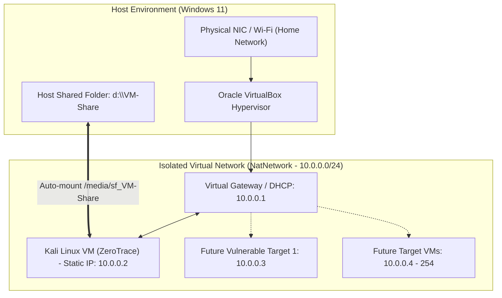
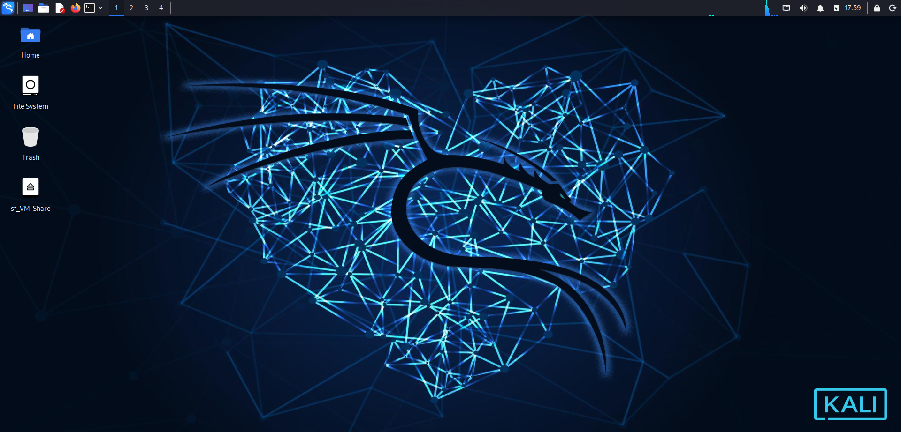
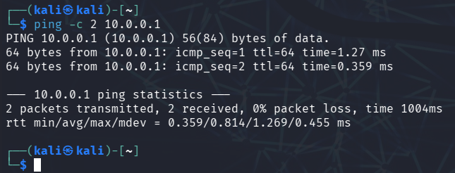
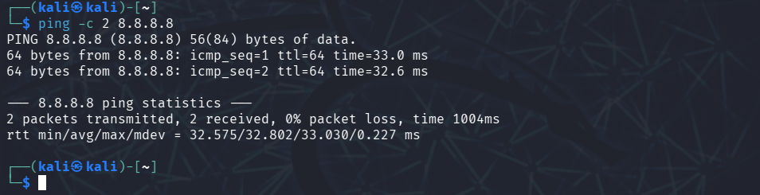
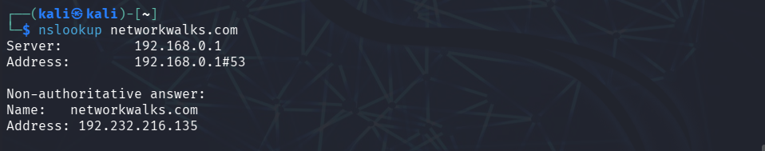
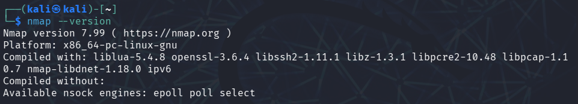

<div align="center">

# 🔐 Cybersecurity Lab Setup - VirtualBox & Kali Linux


[](https://github.com/Dibakor007/NETWORKWALKS-DIBAKOR-B084-WK1-PM1-CYBERSECURITY-LAB-SETUP)


</div>

---

## 🚀 Overview

This repository documents the complete setup of an isolated, secure **Cybersecurity & Penetration Testing Practice Lab** created using **Oracle VirtualBox** and **Kali Linux (ZeroTrace)**. The lab network is isolated within a private NAT Network domain (`10.0.0.0/24`), ensuring hands-on security experimentation without exposing the host operating system or the local home/corporate network to unintended traffic.

---

## 🎯 Objectives

The primary milestones achieved in this setup include:

* **Hypervisor Deployment:** Installed and configured Oracle VirtualBox on a Windows 11 host system.
* **VM Provisioning:** Imported and customized a Kali Linux Virtual Machine (**ZeroTrace**).
* **Segmented Network Architecture:** Designed and configured an isolated VirtualBox NAT Network (`NatNetwork`, `10.0.0.0/24`).
* **Static Addressing:** Assigned and validated permanent static IP addressing (`10.0.0.2/24`) using `nmcli`.
* **Host-to-Guest Integration:** Configured an auto-mounting shared folder (`VM-Share` → `sf_VM-Share`) and bidirectional clipboard/drag-and-drop.
* **Connectivity Verification:** Validated default gateway reachability, public Internet connectivity, and internal DNS resolution.
* **State Preservation:** Captured clean baseline VM snapshots for rapid rollback and recovery during security testing.
* **Standardized Documentation:** Authored a complete technical guide and reference manual for subsequent lab modules.

---

## 🛡️ Purpose of the Lab

Engaging in ethical hacking, vulnerability assessments, and network reconnaissance requires a controlled sandbox. This isolated laboratory environment provides:

* **Risk Mitigation:** Prevents offensive tooling and scanning payloads from leaking into public or production networks.
* **Realistic Topologies:** Simulates standard enterprise IP addressing and routing behavior via dedicated NAT networks.
* **Hands-on Tooling:** Enables unrestricted practice with security utilities such as `nmap`, `netdiscover`, `Wireshark`, and `Metasploit`.
* **Multi-Machine Scalability:** Serves as the foundation for adding vulnerable machines (e.g., Metasploitable, vulnerable Windows targets) in upcoming lab phases.

> ⚠️ **Ethical Disclaimer:** This laboratory is engineered solely for controlled, educational, and authorized security assessments within designated virtual machines. Do not direct any offensive tools toward unauthorized systems.

---

## 🏗️ Lab Architecture

The lab is configured with an isolated private NAT Network (`10.0.0.0/24`) where the VirtualBox virtual router serves as the gateway (`10.0.0.1`), routing outbound traffic through host network address translation while shielding the lab from unauthorized inbound probes.



### 💻 Hardware & Virtual Environment Specifications

| Component | Specification Details |
| :--- | :--- |
| **Host Processor (CPU)** | AMD Ryzen 5 PRO (6 Cores / 12 Threads) |
| **Host System Memory (RAM)** | 16 GB RAM |
| **Host Storage Capacity** | 256 GB SSD |
| **Host Operating System** | Microsoft Windows 11 (64-bit) |
| **Hypervisor** | Oracle VirtualBox v7.2 |
| **Guest Virtual Machine** | Kali Linux (Host: `ZeroTrace`) |
| **Guest vCPU / vRAM** | 4 vCPU Cores / 4096 MB RAM |
| **Storage Allocation** | 32 GB Dynamic VDI (SSD backed) |
| **Virtual NIC Type** | Intel PRO/1000 MT Desktop (`82540EM`) |
| **Lab Network Subnet** | `10.0.0.0/24` (Subnet Mask: `255.255.255.0`) |
| **Gateway / DNS** | `10.0.0.1` |
| **Assigned Guest IP** | `10.0.0.2` (Static Configuration) |

---

## 🛠️ Step-by-Step Setup Guide

### Step 1: Install Extraction Tools (7-Zip)
1. Downloaded the official 64-bit installer from [7-Zip Official Portal](https://www.7-zip.org/).
2. Installed 7-Zip on the Windows 11 host to extract pre-configured virtual appliance `.7z` archives directly to the designated project drive (`D:\`).

### Step 2: Install Oracle VirtualBox
1. Downloaded and executed the **Oracle VirtualBox v7.2** installer.
2. Verified all virtual network drivers (VirtualBox Bridged Networking Driver, VirtualBox Host-Only Ethernet Adapter, and VirtualBox Virtual Network Application Service) were properly initialized during installation.
3. Confirmed accessibility of **File > Tools > Network Manager**.

---

### Step 3: Configure the Isolated NAT Network (`NatNetwork`)
The NAT Network creates a private virtual switch that isolates lab machines while granting controlled outbound internet connectivity.

> ⚠️ **Critical Distinction — Ordinary NAT vs. NAT Network:**  
> If your Kali Linux machine receives an IP address like `10.0.2.15/24`, it is connected to VirtualBox's default ordinary **NAT**. While ordinary NAT allows internet access, it places the VM in an isolated sandbox where it cannot communicate with other target machines. You must connect Kali to a dedicated **NAT Network** (`NatNetwork` on `10.0.0.0/24`) and configure a static address for multi-machine penetration testing.

**Step-by-Step Instructions:**
1. Shut down the Kali Linux VM if it is running.
2. Open **VirtualBox Manager**.
3. Navigate to: **File** > **Tools** > **Network Manager** > **NAT Networks** tab.
4. Click **Create** and configure the network parameters:
   * **Network Name:** `NatNetwork`
   * **IPv4 Prefix:** `10.0.0.0/24`
   * **Enable DHCP:** `Enabled`
   * **Enable IPv6:** `Disabled`
5. Click **Apply** and close the Network Manager.

<p align="center">
  
  <br>
  <em>Figure 1: VirtualBox Network Manager - Configuring NatNetwork (10.0.0.0/24) with DHCP enabled</em>
</p>

---

### Step 4: Connect Kali Linux (`ZeroTrace`) to NatNetwork
1. In VirtualBox Manager, select your Kali VM (**ZeroTrace**) and click **Settings** (or `Ctrl+S`).
2. Under **System**, verify resource allocations:
   * Allocated `4096 MB` RAM.
   * Configured `4 vCPUs` processor cores with PAE/NX enabled.
3. Under **Network**:
   * Select **Adapter 1**.
   * Check **Enable Network Adapter**.
   * Set **Attached to:** **NAT Network** *(⚠️ Do not select ordinary "NAT" here — NAT Network enables lab inter-VM connectivity)*.
   * Set **Name:** `NatNetwork`.
   * Under Advanced, ensure **Adapter Type:** `Intel PRO/1000 MT Desktop (82540EM)`.
   * Check **Virtual Cable Connected**.
4. Click **OK** and start Kali Linux.

<p align="center">
  
  <br>
  <em>Figure 2: ZeroTrace Network Settings - Adapter 1 Attached to NatNetwork with Intel PRO/1000 MT Desktop</em>
</p>

---

### Step 5: Shared Folder & Guest Integrations Setup
To facilitate efficient transfer of wordlists, scripts, logs, and screenshots between the host OS and the Kali Linux guest:

1. **Host Shared Folder Configuration:**
   * Navigate to **Settings > Shared Folders > Machine Folders > Add Share**.
   * **Folder Path:** `D:\VM-Share`.
   * **Folder Name:** `VM-Share`.
   * Options selected: **Auto-mount** (`Checked`) and **Make Machine-permanent** (`Checked`).

<p align="center">
  
  <br>
  <em>Figure 3: VirtualBox Settings - Adding D:\VM-Share with Auto-mount and Machine-permanent enabled</em>
</p>

2. **Clipboard & Drag-and-Drop:**
   * Navigate to **Settings > General > Advanced**.
   * **Shared Clipboard:** `Bidirectional`.
   * **Drag'n'Drop:** `Bidirectional`.

3. **Guest Verification:**
   * Boot the Kali Linux machine.
   * The shared folder automatically mounts to the desktop and filesystem under `/media/sf_VM-Share`.
   * Add the active user to the `vboxsf` permissions group:
     ```bash
     sudo usermod -aG vboxsf $USER
     ```

<p align="center">
  
  <br>
  <em>Figure 4: Kali Linux ZeroTrace active desktop session showing verified sf_VM-Share mount</em>
</p>

---

### Step 6: Assign Kali Linux the Static IP Address
Open the Kali Linux terminal and check the active connection name:

```bash
nmcli connection show
```

Find the active wired connection name. If it is named `Wired connection 1`, assign the permanent static IP:

```bash
# 1. Modify connection parameters for static IPv4, gateway, and DNS
sudo nmcli connection modify "Wired connection 1" \
  ipv4.addresses 10.0.0.2/24 \
  ipv4.gateway 10.0.0.1 \
  ipv4.dns 10.0.0.1 \
  ipv4.method manual

# 2. Apply the configuration
sudo nmcli connection down "Wired connection 1"
sudo nmcli connection up "Wired connection 1"
```

> 📌 *Note: If your connection has a different name, replace `"Wired connection 1"` with the actual name shown by `nmcli connection show`.*  
> 
> ⚠️ **DHCP Pool Collision Prevention:**  
> Ensure the VirtualBox DHCP pool does not dynamically assign `10.0.0.2` to another machine. Set the DHCP range to start at `10.0.0.100` and end at `10.0.0.200` to leave the lower block reserved for static lab hosts.

---

### Step 7: Create a Clean Baseline VM Snapshot
Before conducting offensive exercises or downloading testing packages, capture a clean snapshot to serve as an immutable baseline:

1. Power off the Kali VM cleanly (`sudo poweroff`).
2. Navigate to **VirtualBox Manager** > Select **ZeroTrace** > **Snapshots** > **Take**.
3. **Snapshot Name:** `Clean Base Setup - ZeroTrace Baseline`
4. **Description:** `Initial lab setup with NatNetwork 10.0.0.0/24, static IP 10.0.0.2, shared folder sf_VM-Share, and verified internet access.`

<p align="center">
  
  <br>
  <em>Figure 5: VirtualBox Snapshot Manager - ZeroTrace baseline state management</em>
</p>

---

## 📊 Network Addressing & Architecture Matrix

| Device / Entity | Interface / Role | IP Address | Subnet Mask | Gateway | Purpose |
| :--- | :--- | :--- | :--- | :--- | :--- |
| **VirtualBox Virtual Router** | Default Gateway / DNS | `10.0.0.1` | `255.255.255.0` (`/24`) | — | Routing & NAT translation |
| **Kali Linux (`ZeroTrace`)** | Attacker Workstation | `10.0.0.2` | `255.255.255.0` (`/24`) | `10.0.0.1` | Reconnaissance & offensive testing |
| **Future Target 1** | Target Workstation / Server | `10.0.0.3` | `255.255.255.0` (`/24`) | `10.0.0.1` | Vulnerability assessment (Week 2) |
| **DHCP Target Range** | Dynamic Target Range | `10.0.0.100 - .200`| `255.255.255.0` (`/24`) | `10.0.0.1` | Reserved DHCP pool for target VMs |

---

## 🔬 Lab Verification & Connectivity Testing

Comprehensive verification was performed inside the Kali Linux terminal to validate network addressing, gateway routing, public transit, and domain resolution.

### 1. Gateway Connectivity Test (`10.0.0.1`)
```bash
ping -c 2 10.0.0.1
```

<p align="center">
  
  <br>
  <em>Figure 6: Gateway reachability test - 2 packets transmitted, 2 received, 0% packet loss</em>
</p>

### 2. Public Internet Connectivity Test (`8.8.8.8`)
```bash
ping -c 2 8.8.8.8
```

<p align="center">
  
  <br>
  <em>Figure 7: Public Internet reachability test - 2 packets transmitted, 2 received, 0% packet loss</em>
</p>

### 3. DNS Resolution Test (`networkwalks.com`)
```bash
nslookup networkwalks.com
```

<p align="center">
  
  <br>
  <em>Figure 8: DNS resolution verification via nslookup resolving networkwalks.com to 192.232.216.135</em>
</p>

### 4. Security Tooling & Environment Verification (`nmap`)
```bash
nmap --version
```

<p align="center">
  
  <br>
  <em>Figure 9: Security tooling verification - Nmap version 7.99 operational on ZeroTrace workstation</em>
</p>

### 5. Shared Folder Mount Verification
```bash
ls -la /media/sf_VM-Share
df -h | grep sf_
```

---

### 📋 Expected Configuration & Results Matrix

| Item | Expected Value | Command | Status |
| :--- | :--- | :--- | :---: |
| **Kali IP** | `10.0.0.2/24` | `ip a` | ✅ 10.0.0.2/24 assigned |
| **Gateway** | `10.0.0.1` | `ping -c 2 10.0.0.1` | ✅ Reachable (0% loss) |
| **Network** | `10.0.0.0/24` | `ip a` | ✅ Isolated NAT Network |
| **Default Route** | `default via 10.0.0.1` | `ip route` | ✅ Set via 10.0.0.1 |
| **Internet Access** | Ping succeeds (`8.8.8.8`) | `ping -c 2 8.8.8.8` | ✅ 0% loss (avg 32.8ms) |
| **DNS Resolution** | Domain resolves (`networkwalks.com`) | `nslookup networkwalks.com` | ✅ Resolved to 192.232.216.135 |
| **Security Tooling**| Nmap installed and operational | `nmap --version` | ✅ Nmap v7.99 ready |
| **Shared Folder** | `/media/sf_VM-Share` mounted | `ls -la /media/sf_VM-Share` | ✅ Auto-mounted & accessible |

---

## 🪲 Problems Encountered & Troubleshooting Solutions

| # | Issue Encountered | Root Cause | Implemented Solution |
| :---: | :--- | :--- | :--- |
| **1** | **NAT Network missing in VM Settings** | In VirtualBox 7.x, global NAT Networks are managed at the hypervisor level rather than inside per-VM settings. | Opened **VirtualBox > Tools > Network Manager > NAT Networks** to create the global switch first. |
| **2** | **Permission Denied accessing `sf_VM-Share`** | Linux restricts access to auto-mounted VirtualBox shares to members of the `vboxsf` user group. | Executed `sudo usermod -aG vboxsf $USER` and restarted the desktop session. |
| **3** | **Network Connection drop after manual IP edit** | Modifying connection profiles via `nmcli` requires toggling the link to refresh NetworkManager caches. | Chained restart commands: `sudo nmcli con down "Wired connection 1" && sudo nmcli con up "Wired connection 1"`. |
| **4** | **DNS failure when using external DNS only** | Some virtual hypervisor NAT network configurations drop direct upstream DNS queries unless routed through the gateway. | Configured `ipv4.dns` to `10.0.0.1` (VirtualBox Gateway proxy), ensuring reliable lookups. |
| **5** | **Path case-sensitivity in Linux Terminal** | Linux filesystem is case-sensitive (`VM-Share` vs `vm-share`). | Verified exact capitalization of mount points using `ls /media/` and autocomplete via Tab. |

---

## 💡 Key Learnings & Takeaways

1. **Standard NAT vs. NAT Network:**
   * Standard VirtualBox **NAT** provides internet access to a single VM but completely isolates VMs from communicating with each other.
   * **NAT Network** acts as a virtual switch connecting multiple VMs on a shared private subnet (`10.0.0.0/24`), enabling multi-machine attacker/target interactions while still maintaining outbound internet access.
2. **Declarative Network Management via `nmcli`:**
   * Acquired proficiency with Linux NetworkManager command-line interface (`nmcli`) for reliable static IP assignments without relying on GUI applets.
3. **Hypervisor Integration Capabilities:**
   * Configured bidirectional clipboard channels and native shared folder mounts to streamline file transfers between host and guest.
4. **Snapshot Discipline:**
   * Realized the necessity of capturing clean, pre-attack VM snapshots to avoid complete reinstallation upon kernel or configuration corruption during penetration testing exercises.
5. **Technical Documentation Standards:**
   * Formatted and documented technical architecture, network parameters, and commands according to professional cybersecurity reporting standards.

---

## 🔐 Security & Ethical Guidelines

* **Restricted Target Scope:** Testing is strictly limited to explicitly designated targets within the `10.0.0.0/24` lab subnet.
* **No Public Attacks:** No penetration testing, scanning, or fuzzing payloads shall ever be directed toward public internet endpoints or unauthorized third parties.
* **Credential Hygiene:** Default passwords inside lab VMs must be updated, and production host credentials must never be shared inside test environments.

---

## 🔗 Tools & Resources

* [Oracle VirtualBox Hypervisor](https://www.virtualbox.org/)
* [Kali Linux Official Distribution](https://www.kali.org/get-kali/)
* [7-Zip Compression Utility](https://www.7-zip.org/)
* [NetworkManager CLI (nmcli) Documentation](https://developer.gnome.org/NetworkManager/stable/nmcli.html)

---

## 🧑‍💻 Author
**Dibakor Pramanik - Batch B084**  
Cybersecurity Student at NetworkWalks

---

## 📌 Project Information
* **Program:** Cybersecurity at NetworkWalks
* **Batch:** B084
* **Week:** 01
* **Project:** Cybersecurity & Pentesting Lab Setup
* **Status:** 🟢 **LAB READY** — Ready for Week 02 (Vulnerable Target Integration)
